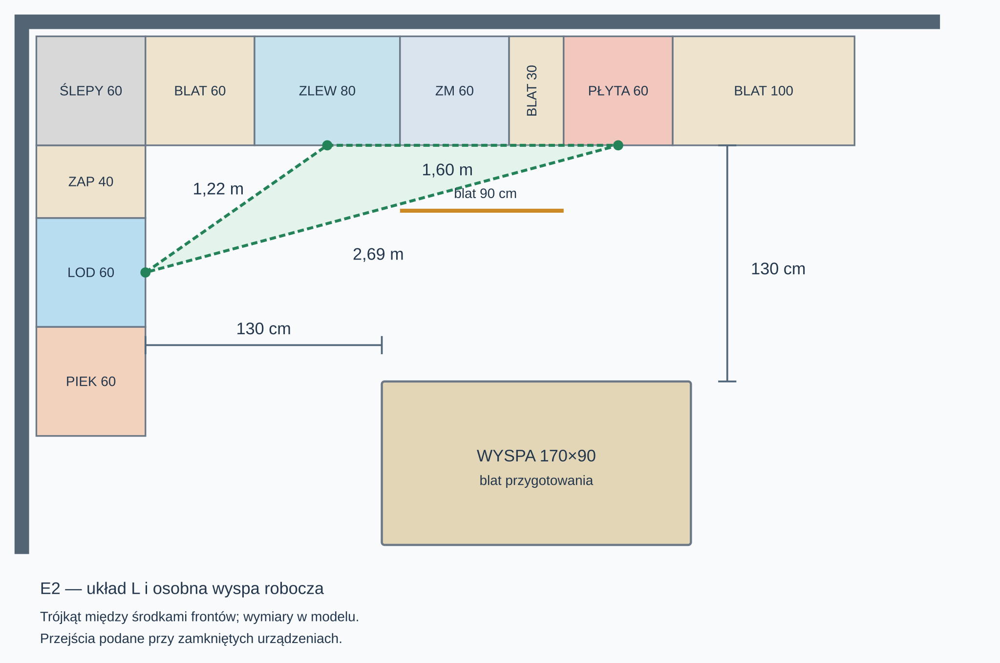
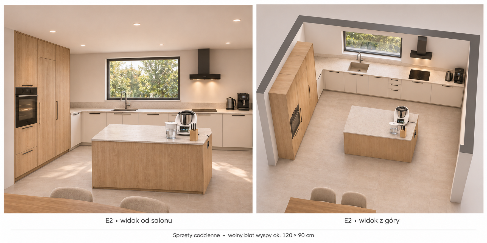

> Układ historyczny sprzed ostatniej przebudowy kuchni. Aktualne słupki, wyspa 170×100 cm, przejścia 120 cm i hokery: [plan kuchni 3D](kuchnia3d-plan.md) oraz [audyt domu](audyt-projekt-glowny.md).

# Kuchnia E2 — ergonomia po korekcie

Układ L z osobną wyspą jest sensowny. Zachowane 130 cm między wyspą a północnym blatem i zachodnimi słupkami daje wygodne miejsce do pracy. Poprawiono kolejność sprzętów i skrócono najdłuższy bok trójkąta pracy, bez przesuwania ścian, zlewu, zmywarki ani wyspy.

## Trójkąt pracy

Pomiar między **środkami frontów** lodówki, szafki zlewu i płyty; odcinki proste, nie symulacja kroków człowieka. Orientacyjna reguła projektowa to około 1,2–2,7 m na bok i 4–8 m łącznie; nie jest to potwierdzenie spełnienia norm ani dostępności.

| Odcinek | Przed korektą | Po korekcie |
| --- | ---: | ---: |
| Lodówka → zlew | 1,64 m | 1,22 m |
| Zlew → płyta | 1,90 m | 1,60 m |
| Płyta → lodówka | 3,18 m | 2,69 m |
| Suma | 6,72 m | 5,51 m |

Wyspa nie przecina tych odcinków. Najdłuższy bok nadal jest przy górnej granicy reguły; trójkąt nie zastępuje oceny blatów i otwierania urządzeń.

## Kolejność mebli i sprzętów

**M71, zachodnia ściana, od południa:** piekarnik 60 → lodówka 60 → dostępny słupek zapasów 40 → niski ślepy narożnik 60 cm. Lodówka E1 i piekarnik E2 zamienione miejscami, ich ID zachowane. Zawiasy lodówki proponowane od południa, przy piekarniku, uchwyt od północy. Pełne otwarcie i wyjmowanie szuflad trzeba sprawdzić dla konkretnego modelu.

W poprzednim rzucie opisano 100 cm wysokiej szafy na zapasy, ale 60 cm jej frontu zasłaniał północny blat. Pozostaje realnie dostępne 40 cm, a zasłonięty odcinek jest teraz oznaczony jako niski, ślepy narożnik, bez deklarowania dostępnej wysokiej szafy. Nowy narożnik ma własne ID E4; istniejący słupek zachowuje E3. Blat odkładczy lodówki to 60 cm po lewej stronie zlewu. Gorące blachy z piekarnika można odkładać na wyspę naprzeciw, ale wymaga to przeniesienia przez przejście 130 cm — blat bezpośrednio obok piekarnika byłby wygodniejszy.

**M72, północna ściana, od zachodu:** blat 60 → zlew 80 → zmywarka 60 → szuflady 30 → płyta 60 → blat 100 cm. Płyta E5 przesunięta o 30 cm w lewo, bez zmiany jej ID. Wymaga to odpowiedniego położenia okapu i zasilania. Krawędź płyty jest 10 cm na prawo od krawędzi otworu okiennego; wymagania wybranego sprzętu i szczegóły okapu trzeba sprawdzić wykonawczo.

Między zlewem a płytą pozostaje **90 cm ciągłego blatu przygotowania**, w tym 60 cm nad zmywarką. Wcześniej było 120 cm: skrócenie jest świadomym kompromisem na rzecz krótszej drogi od lodówki i większego blatu po prawej. Wyspa **170×90 cm**, bez zlewu i płyty, daje dodatkową dużą powierzchnię przygotowania. Zmywarka nadal bezpośrednio przy zlewie; naczynia i sztućce warto trzymać w sąsiednich szufladach i wyspie.

Na prawym blacie 100 cm zostawić pierwsze **40 cm przy płycie wolne** na odstawianie. Aktualna propozycja rozmieszczenia pięciu codziennych przedmiotów znajduje się poniżej. Pozostałego małego AGD nie należy stale ustawiać na blacie przygotowania. Używanie go w spiżarni jest możliwością do osobnego sprawdzenia pod kątem miejsca, wentylacji i zasilania, nie gotowym projektem instalacji.

## Sprzęty codzienne — propozycja do wizualizacji

Użytkownik wskazał pięć rzeczy stale obecnych na blacie: **ekspres, Thermomix, czajnik, dzbanek na wodę i noże**. Wszystkich nie należy upychać w końcowych 60 cm północnego blatu. Propozycja zachowuje dotychczasowe meble i przejścia, ale rezerwuje część wyspy na sprzęty:

| Miejsce | Wyposażenie | Założenie |
| --- | --- | --- |
| Końcowe 60 cm prawego blatu | Ekspres i czajnik | Orientacyjnie 30 + 22 cm szerokości; pozostałe miejsce na odstępy, do potwierdzenia dla konkretnych modeli. Pierwsze 40 cm przy płycie pozostaje wolne. |
| Prawy pas wyspy, około 50×90 cm | Thermomix z tyłu, dzbanek i kompaktowy blok noży przed nim | Orientacyjne obrysy: 35×40, 18×18 i 12×18 cm. Nie są to dane posiadanych urządzeń ani potwierdzone odstępy producentów. |
| Pozostała część wyspy | Wolny blat około 120×90 cm | Rezerwa do przygotowania posiłków; dokładny wymiar zależy od modeli i wymaganych odstępów. |

Blat 90 cm między zlewem a płytą oraz blat 60 cm na lewo od zlewu pozostają wolne. Thermomix wymaga stabilnego ustawienia, marginesów od krawędzi i wolnej przestrzeni dla pary według instrukcji urządzenia. Założono gniazdo przy wyspie z krótkim przewodem; nie wolno planować zasilania przewodem przez przejście. Lokalizację i wykonanie zasilania trzeba opracować elektrycznie. Noże w stabilnym bloku ustawionym w głębi blatu; sposób zabezpieczenia dobrać do domowników.

Wizualizacja przedstawia propozycję materiałów i ustawienia sprzętów. Wygenerowany obraz nie jest modelem CAD ani podstawą do mierzenia prześwitów. Rzut 2D i jego zapis v30 nie zostały w tym etapie zmienione; sprzęty przenośne nie mają jeszcze osobnych obiektów w edytorze.

## Prześwity i ograniczenia

- Wyspa → północny blat oraz zachodnia zabudowa: **130 cm** przy zamkniętych frontach. Po otwarciu drzwi urządzenia na około 60 cm zostaje około **70 cm**, bez wygodnego mijania. Nie otwierać zmywarki jako stałego elementu pracy dwóch osób.
- Od wschodu wyspy: **90 cm**. Do zamkniętego stołu: **135 cm**; do zajętych krzeseł przy stole dla dziesięciu osób: **75 cm**, układ okazjonalny, bez komfortowej obsługi wyspy z tej strony.
- Miary dotyczą obrysów w modelu. Uchwyty, rzeczywiste fronty, instalacje, wysokość okapu i mechanizmy drzwi wymagają doboru wykonawczego. Edytor nie symuluje otwierania poszczególnych urządzeń w zabudowie.
- Kontrola rastra 50 mm po korekcie kuchni: zero problemów i wszystkie pomieszczenia dostępne. Późniejszy większy narożnik M76 zmienia ograniczenia salonu: [aktualny §20 wymagań](wymagania-projektowe.md#20-e2--rzeczywisty-gabaryt-narożnika-m76). Jednoczesne rozłożenie M75/M76 nie jest potwierdzone. Pozostają wcześniejsze ostrzeżenia M101 oraz trzech PAX, dodatkowo uwagi stołu i dojścia M76; nie są skutkiem korekty kuchni. Przy rozłożonej sofie M117 pozostaje wcześniejsza uwaga o strefie krzesła M116.

Zapis v30 przenosi z v29 tylko wyposażenie i opis M71/M72 w E2. Zachowuje własne nazwy, obrysy obu zabudów, pozostałe edycje i wszystkie inne warianty; kopie starszych zapisów pozostają. Bieżący v30 nie jest ponownie korygowany. Import JSON nadal odtwarza zawartość pliku.

Kontrola: `node tools/check_e2_kitchen.js`, `node tools/check_e2_room_updates.js`, `node tools/check_e2_island.js`, `node tools/check_variant.js E2` oraz testy przeglądarkowe.
